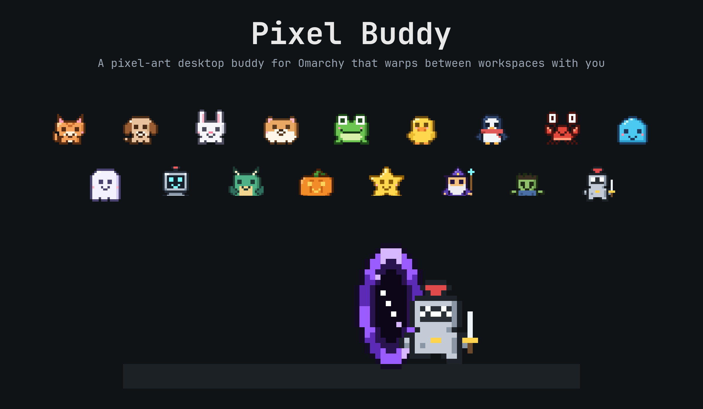
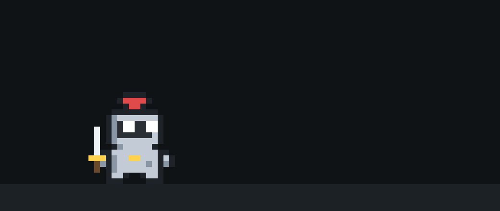
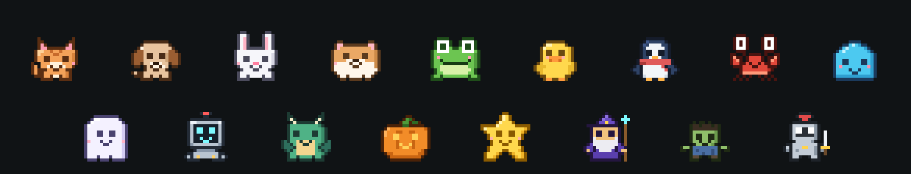
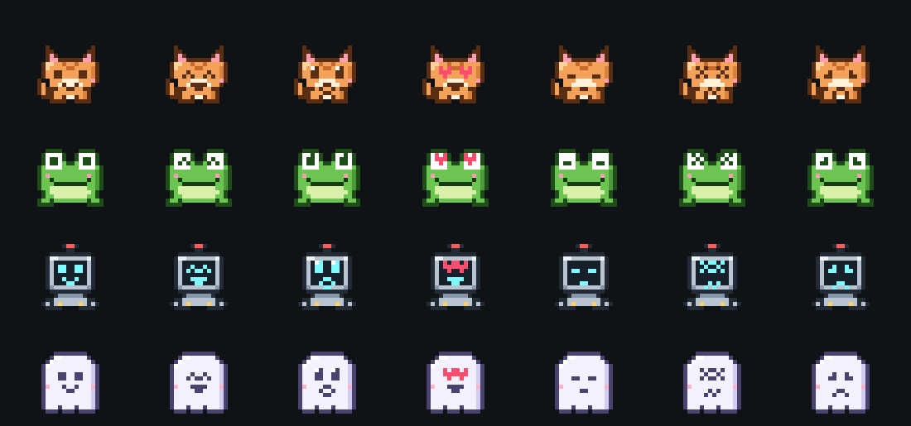
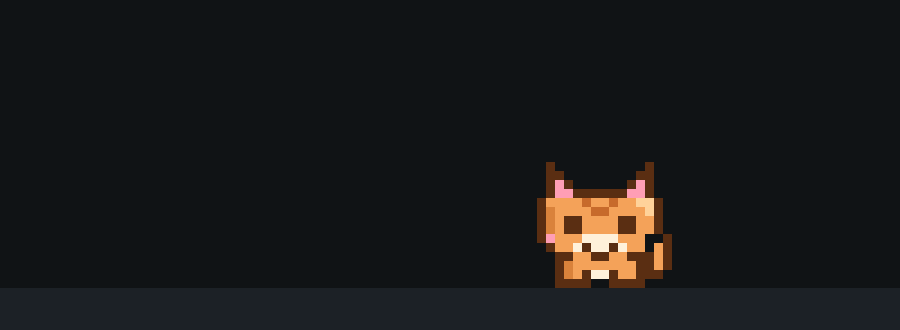
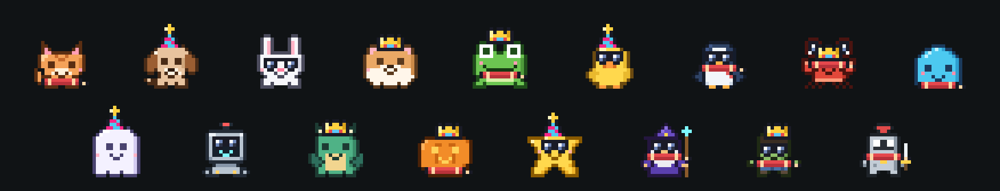

# Pixel Buddy for Omarchy

**A pixel-art desktop buddy that hops between your windows, follows you through a portal on every workspace switch, reacts to what you're working on, keeps you company through focus sessions, has friends over now and then, and reminds you to stretch.**

<p align="center">
  
</p>

```bash
omarchy plugin add https://github.com/TannerBurns/omarchy-pixel-buddy --enable --yes
```

## Features

- **Seventeen characters, a new one every day.** Cat, Puppy, Bunny, Hamster, Frog, Duck, Penguin, Crab, Blob, Ghost, Robot, Dragon, Pumpkin, Star, Wizard, Zombie and Knight. "Surprise me daily" picks a different one each morning, never the same twice in a row, and you can pin any of them from the right-click menu.
- **It travels with you.** Every workspace switch opens a pixel portal in your theme's accent color: the buddy walks in on one side and steps out on the other. The scratchpad gets a floor portal, and when you move to another monitor the buddy portals over to it.
- **Window hopper.** It walks along the bottom of the screen, hops onto floating windows you focus and rides along when they move, dangles from a window edge now and then, and falls when the window under it closes. It never sits on your bar. Patrol, Roam and Stay modes keep it calmer.
- **It watches what you do.** Its eyes follow your cursor. It sits with a laptop while you code or work with an AI agent, reads while you browse, glances at new windows and notifications, and naps when you step away.
- **Drag it anywhere.** Pick it up, fling it, drop it. Where you drop it on or under a window becomes its spot for that app.
- **Signature moves.** Double-click it and each character does its own thing: the puppy wags, the frog flicks its tongue, the dragon puffs fire, the penguin belly-slides. Now and then it shows off on its own.
- **Personalities.** Characters act like themselves: the cat takes naps and gives some pets the cold shoulder, the puppy trots after your pointer, the hamster scurries about, the dragon flies up to high windows, the ghost drifts all over, the knight walks its beat and the zombie takes it slow.
- **Friends drop by.** Every 45 minutes or so another character steps out of a portal next to your buddy. They say hi, show off their moves, cheer together, and the friend heads home. You can switch visits off in the menu, and invite a friend any time.
- **Stats and a wardrobe.** It keeps count of your stretches, focus rounds and day streak, and unlocks a scarf, a party hat, sunglasses and a crown along the way. Your buddy wears them on screen and on the bar.
- **Character handoffs.** Pick a new character (or let the daily surprise change) and the old one walks into a portal while the new one steps out of another.
- **Focus timer.** Start a focus round (25 minutes by default) and the buddy turns on Do Not Disturb and jumps up through a portal to wait on your bar, leaving your windows alone, with the minutes left next to its face. When the round ends it drops back down, offers a stretch for your break, and asks if you want another round.
- **On your bar.** Its face sits on the bar, in the left, center or right section, as you like. Click it to call the buddy over (it drops out of a portal right under the icon), right-click for the menu, middle-click to start or stop focus.
- **Git celebrations.** It celebrates when you commit and leaps when you push, in any repository under your work folders. It only ever reads git's one-word record of what happened, never your commit messages.
- **It notices your system.** It spins when you change your Omarchy theme (theme-tinted buddies recolor mid-spin) and can celebrate a finished `omarchy update` (see [Update celebration](#update-celebration)).
- **Stretch reminders that change every time.** After a long stretch of work it waits for a natural pause, then walks you through one of 22 stretches across eight categories and acts each one out. After long coding sessions it favors wrists, eyes and neck; it never picks the same category twice in a row. It stays quiet during fullscreen apps, Do Not Disturb and screen sharing.
- **Bring your own character.** Drop a JSON file of pixel rows into `~/.config/pixel-buddy/characters/` and it appears in the menu. Edits show up live.
- **Light on resources.** It only draws when something changes: about 1% of one CPU core while it wanders, far less while it sits still. On battery it switches to a [battery saver](#battery-saver) that draws and polls even less.

## Screenshots

<p align="center">
  
</p>

| The characters | Shared expressions |
| :---: | :---: |
|  |  |

| A friend drops by | The wardrobe |
| :---: | :---: |
|  |  |

*These images are rendered from the plugin's own sprite and portal code (`scripts/make-media.sh`), so they match what runs on your desktop.*

## Install

```bash
omarchy plugin add https://github.com/TannerBurns/omarchy-pixel-buddy
```

Omarchy shows its standard warning about third-party plugins, clones the repository, and asks whether to enable it. Add `--enable --yes` to skip the questions. The buddy appears right away.

**Update:** `omarchy plugin update tannerburns.pixel-buddy && omarchy restart shell`. The buddy stays loaded while other plugins reload, so a new version takes effect when the shell restarts.

**Updating from 0.2 or earlier?** Run this once after the shell restarts, to put the buddy's icon on your bar. It keeps your settings:

```bash
bash ~/.config/omarchy/plugins/tannerburns.pixel-buddy/scripts/add-to-bar.sh
```

Until you do, the buddy keeps working but `omarchy plugin list` shows it as disabled.

### Keyboard shortcut (optional)

Add these to `~/.config/hypr/bindings.lua` to show and hide the buddy, and to start or stop a focus round:

```lua
o.bind("SUPER + ALT + B", "Pixel Buddy", "omarchy-shell pixel-buddy toggle")
o.bind("SUPER + ALT + P", "Pixel Buddy focus", "omarchy-shell pixel-buddy focus toggle")
```

## Uninstall

```bash
omarchy plugin remove tannerburns.pixel-buddy
rm -rf ~/.local/state/pixel-buddy ~/.config/pixel-buddy   # optional: saved spots, stretch history, custom characters
```

Removing the plugin takes its bar icon with it. The icon is also the plugin's place in your Omarchy settings: remove the widget from the bar and the buddy goes too (to hide just the icon, use `set barIcon false`). Remove the keyboard shortcuts too if you added them, and the update hook if you installed it (`rm ~/.config/omarchy/hooks/post-update.d/pixel-buddy.sh`).

## Usage

| Input | Action |
| --- | --- |
| Drag | Pick it up and move it. Fling it to throw it. |
| Click | Pet it. |
| Double-click | Its signature move. |
| Right-click | Menu: character, surprise me daily, mode, size, colors, motion, friend visits, bar section, focus, stretch now, invite a friend, snooze reminders, hide, the wardrobe and today's stats. |
| Bar icon | Click: call the buddy over. Middle-click: start or stop focus. Right-click: the menu. Hover: next stretch, focus time and today's stats. |
| Super+Alt+B | Show or hide it (with the shortcut above). |
| Super+Alt+P | Start or stop a focus round (with the shortcut above). |

Everything is also scriptable:

```bash
omarchy-shell pixel-buddy toggle                 # show or hide
omarchy-shell pixel-buddy show
omarchy-shell pixel-buddy hide
omarchy-shell pixel-buddy character frog         # or: daily (plays the portal handoff)
omarchy-shell pixel-buddy mode stay              # hopper, patrol, roam, stay
omarchy-shell pixel-buddy set breakMinutes 30    # any setting below
omarchy-shell pixel-buddy stretch                # a stretch break right now
omarchy-shell pixel-buddy focus toggle           # also: start, stop, status, or minutes (focus 50)
omarchy-shell pixel-buddy git status | jq        # also: rescan
omarchy-shell pixel-buddy bar left               # move the bar icon: left, center or right
omarchy-shell pixel-buddy friend random          # a friend comes over now (or name one: friend frog)
omarchy-shell pixel-buddy stats | jq             # today, this week, the streak and what's unlocked
omarchy-shell pixel-buddy wear scarf             # put on an unlocked accessory; wear none takes everything off
omarchy-shell pixel-buddy preview crown          # try on any accessory for ten seconds
omarchy-shell pixel-buddy resetStats             # forget the stats and the unlocked accessories
omarchy-shell pixel-buddy answer done            # answer an open stretch bubble: done, later, skip
omarchy-shell pixel-buddy react celebrate        # a reaction, see below
omarchy-shell pixel-buddy warp left              # play a workspace portal: left, right or down
omarchy-shell pixel-buddy menu                   # open the menu next to the buddy
omarchy-shell pixel-buddy reloadCharacters       # rescan custom characters
omarchy-shell pixel-buddy reset                  # forget the spots it learned for your apps
omarchy-shell pixel-buddy status | jq            # character, mode, battery saver, next stretch
omarchy-shell pixel-buddy debug | jq             # monitors, ledges and perches (window classes only)
```

### Reactions

`omarchy-shell pixel-buddy react <name>` plays one of these, and answers `unknown` for anything else. They're handy in your own scripts and Omarchy hooks.

| Name | Reaction |
| --- | --- |
| `pet` | A heart and a happy hop, like a click. |
| `special` | Its signature move. |
| `celebrate` | Its signature move with sparkles. |
| `done` | Its signature move with a heart (after a finished stretch). |
| `cheer` | Arms up, with a sparkle. |
| `spin` | A quick spin (it does this when the theme changes). |
| `heart` | Heart eyes. |
| `notify` | Looks up as if a notification arrived. |
| `question` | A question mark. |
| `dizzy` | Spinning eyes. |
| `sad` | A sad face. |
| `yawn` | A yawn. |
| `sleep` | A short nap. |
| `wake` | Wakes up with a start. |
| `flop` | Flops over, tired. |
| `battery` | A tired face with a low battery. |
| `charging` | A lightning bolt. |
| `hang` | Climbs up and dangles from the focused window. |
| `hop` | Hops back to its spot. |
| `leap` | A big hop in place with a lightning bolt (a git push). |
| `sparkle` | A sparkle. |

## Movement modes

- **Hopper** (default). Gravity applies. With your usual maximized windows there's no room on top of them, so the buddy lives on the floor under the right end of the focused window, and now and then climbs up and dangles from its top edge before letting go. It hops onto floating windows you focus, rides along when you move them, and falls when they close. It follows focus only after focus has settled, so moving the mouse across windows doesn't send it bouncing around.
- **Patrol.** No gravity. It wanders near its home spot; wherever you drop it becomes home.
- **Roam.** No gravity. It walks the whole width of the line it's standing on.
- **Stay.** It stays exactly where you put it, still animating and reacting.

## Settings

Settings live in the plugin's entry in `~/.config/omarchy/shell.json`. The right-click menu and `omarchy-shell pixel-buddy set <key> <value>` write them, or you can edit the entry by hand. Invalid values fall back to the default.

| Key | Default | Description |
| --- | --- | --- |
| `character` | `daily` | A character id (`cat`, `knight`, a custom id) or `daily` for a new one each day. |
| `mode` | `hopper` | `hopper`, `patrol`, `roam` or `stay`. |
| `size` | `medium` | `small`, `medium` or `large`: 2, 3 or 4 screen pixels per art pixel. |
| `colors` | `natural` | `theme` tints characters with your Omarchy theme's accent color. |
| `motion` | `full` | `calm` walks slower and fades between workspaces instead of using portals. |
| `warp` | `portal` | `portal`, `fade` or `none` on a workspace switch. |
| `overFullscreen` | `false` | `true` keeps it above fullscreen apps and the screensaver. |
| `followCursor` | `true` | Eyes follow the pointer. |
| `screencast` | `calm` | While your screen is shared: `calm` (no portals or reminders), `hide` or `normal`. |
| `batterySaver` | `auto` | `auto` (on battery), `on` or `off`. See [Battery saver](#battery-saver). |
| `wellbeing` | `true` | Stretch and bedtime reminders. |
| `breakMinutes` | `45` | Active minutes between stretch breaks (1-480). |
| `stretches` | `all` | Categories to use, e.g. `wrists,eyes,neck`. |
| `bedtime` | `23:00` | When it starts yawning and suggests wrapping up for the night; `off` turns it off. |
| `battery` | `true` | A tired face on low battery, a sparkle when you plug in. |
| `focusMinutes` | `25` | Length of a focus round (1-180). |
| `focusBreakMinutes` | `5` | The break after it (1-60). |
| `focusDnd` | `true` | Turn on Do Not Disturb during focus. |
| `barIcon` | `true` | Show the buddy's icon on the bar. `false` hides just the icon. |
| `gitCelebrate` | `true` | Cheer on commits and leap on pushes. |
| `gitRoots` | `~/Work,~/Code,~/Projects,~/src` | Up to five folders to look for repositories in (four levels deep). Missing ones are skipped. |
| `personality` | `true` | Characters behave like themselves. `false` makes them all behave the same. |
| `friends` | `true` | Other characters visit now and then. |
| `friendEvery` | `45` | Minutes between visits, give or take a few (10-480). |
| `stats` | `true` | Count stretches, focus rounds, your streak and active time, and unlock accessories. |

```bash
omarchy-shell pixel-buddy set colors theme
omarchy-shell pixel-buddy set stretches wrists,eyes,neck
```

## Stretch reminders

The buddy counts active time. Being idle for five minutes or more counts as a break and resets the count, and so does a suspend. Once `breakMinutes` of active time add up, it waits until you pause for a few seconds, then shows a bubble with a guided stretch, a countdown and its own demonstration. **Done** counts toward today's total, your stats and how many you've done in a row, **Later** asks again in ten minutes, and **Skip** resets the timer and the run.

| Category | Stretches |
| --- | --- |
| Neck | Neck tilt, Chin tucks, Look over your shoulders |
| Shoulders | Shoulder rolls, Overhead reach, Chest opener, Cross-body shoulder stretch |
| Wrists | Wrist flexor stretch, Wrist extensor stretch, Fist and spread, Prayer stretch |
| Back | Seated twist, Side bend, Seated cat-cow |
| Eyes | 20-20-20 eye break, Palming |
| Legs | Stand up and walk, Calf raises, Standing quad stretch |
| Breathing | Box breathing (the buddy inflates and deflates as your pacer), Physiological sigh |
| Water | Water break |

It doesn't repeat a stretch until it has used every one in the categories you allow. The stretches are gentle and general. Stop if anything hurts, and leave out any category that doesn't suit you with the `stretches` setting.

After `bedtime` it wears a nightcap, yawns more, and once a night suggests wrapping up. The menu's **Snooze reminders 1h** pauses stretch reminders for an hour.

## Focus timer

Start a round from the bar icon (middle-click), the menu, `Super+Alt+P` or `omarchy-shell pixel-buddy focus toggle`. The buddy jumps up through a portal and waits on the bar for `focusMinutes`, so nothing moves on your windows; the bar icon shows its face and the minutes left. Stretch reminders and notifications wait too: it turns on Do Not Disturb when the round starts, if it was off. (With the bar icon hidden it stays on screen instead, sitting quietly beside a tomato timer.)

When the round ends it switches Do Not Disturb back off, drops back down out of a portal under the bar icon, cheers, and offers a stretch for your `focusBreakMinutes` break. After the break it asks whether you want another round. Do Not Disturb follows you: if you switch it off by hand during a round, the buddy leaves it off, and if it was already on before you started, the buddy leaves it on. Rounds keep running while the buddy is hidden and survive a shell restart or a suspend.

`omarchy-shell pixel-buddy focus 50` starts a 50-minute round once, without changing `focusMinutes`.

## Personalities

Each built-in character has its own way of going about its day:

| Character | Personality |
| --- | --- |
| Cat | Naps during the day, and shrugs off some pets: it turns its back with a "…". |
| Puppy | Trots after your pointer when you move it, then wags. |
| Hamster | Zippy: quick steps, short rests and lots of little trips. |
| Dragon | Flies up to high windows instead of taking a portal. |
| Ghost | Wanders far and often. |
| Knight | Walks its beat end to end and turns smartly at each end. |
| Zombie | Low energy: long sits and the odd shuffle. |

The rest behave the way every character used to. `set personality false` makes them all behave alike, and custom characters can have a personality too (see [docs/characters.md](docs/characters.md#personality)).

## Friends

Every `friendEvery` minutes or so (45 by default; the first time about ten minutes in), another character steps out of a portal beside your buddy. They greet each other, each does its signature move, they cheer, trade hearts, and the friend walks back into its portal. A visit takes about ten seconds and never moves your buddy from its spot.

Friends stay away while you're in a fullscreen app, sharing your screen, focusing, away from the keyboard, or answering a stretch, and anything that needs your buddy sends a visiting friend home early: picking it up, switching workspaces or monitors, hiding it, or a new character.

Switch visits off in the menu (**Friends: Off**) or with `set friends false`. **Invite a friend** in the menu, or `omarchy-shell pixel-buddy friend frog`, brings one over right away, even with visits off.

## Stats and wardrobe

The buddy keeps count of your Done stretches, finished focus rounds and your day streak (days with at least one of either; days start at 4 a.m.), plus how much of your active time went to each kind of work. The menu shows today, and so does the bar icon's tooltip; `stats` has the week.

Milestones unlock accessories for your buddy:

| Accessory | Unlocks after |
| --- | --- |
| Scarf | 10 stretches |
| Party hat | a 3-day streak |
| Sunglasses | 5 focus rounds |
| Crown | a 7-day streak |

The buddy tells you when one unlocks and offers to put it on. Click a wardrobe tile in the menu to wear or take off what you've unlocked (one hat at a time); locked tiles show how far along you are. At bedtime the nightcap takes the place of a hat. `preview crown` tries one on for ten seconds, unlocked or not.

## Bar icon

The buddy's face sits on the right of the bar when you install it. Move it with the menu's **Bar** row (Left, Center, Right), `omarchy-shell pixel-buddy bar center`, or Omarchy's own `omarchy bar move tannerburns.pixel-buddy --section left`. `set barIcon false` hides just the icon; during focus the buddy then stays on screen.

## Git celebrations

The buddy watches the repositories under `gitRoots` and reacts when you commit (its signature move) or push (a big leap with a lightning bolt). Fetching, pulling, switching branches and rebasing don't count. It celebrates at most every 20 seconds and 40 times a day, stays quiet while it's hidden or waiting on the bar during focus, and goes quiet for a minute when commits pour in (an agent at work).

It reads the action word of each new entry in git's reflog (`commit`, `commit (amend)`, `update by push`) and nothing else: no commit messages, branch names, file names or remotes leave the small watcher script. New repositories are picked up within 30 minutes; `omarchy-shell pixel-buddy git rescan` looks right away. It uses `inotifywait` (from inotify-tools) when it's installed, and otherwise checks every 30 seconds.

## Battery saver

Each frame the buddy draws costs a little CPU, so on battery it does less: fewer, slower animation frames, less wandering, no dangling or showing off on its own, and slower checks of the pointer and your windows. Workspace portals and stretch reminders work as usual. `batterySaver` set to `on` keeps it that way on power too, and `off` turns it off. `status` reports `"saver": true` while it's active.

## Update celebration

The buddy can cheer when `omarchy update` finishes. Install the hook it ships with once:

```bash
omarchy hook install post-update ~/.config/omarchy/plugins/tannerburns.pixel-buddy/hooks/pixel-buddy.sh
```

The hook calls `omarchy-shell -q pixel-buddy react celebrate` and never fails an update, even when the buddy isn't running. Remove it with `rm ~/.config/omarchy/hooks/post-update.d/pixel-buddy.sh`.

## Custom characters

Put a character file in `~/.config/pixel-buddy/characters/` and pick it from the menu. Only an `idle` pose is required. Every other pose falls back to one you drew, and the eyes, expressions, props and portal come from the plugin. Draw a `special` pose to give it a signature move. See [docs/characters.md](docs/characters.md) for the format and a complete small example. The built-in characters in [characters/](characters) are full examples too.

## Privacy

- Window titles are only used to guess what kind of work you're doing (coding, browsing, chat and so on). They are never stored, logged or shown; `status` and `debug` report categories and window classes only.
- It notices that a notification arrived, from a new file in Omarchy's notification folder, but never reads it. Notifications held back by Do Not Disturb don't reach that folder.
- Git celebrations read only the one-word action of new reflog entries in your repositories. Commit messages, branch names, file names and remotes are never read into the buddy, stored or logged.
- The focus timer switches Do Not Disturb through Omarchy's own notification service, and only back off when it was the one that switched it on.
- The stats keep, for the last seven days, how many minutes you were active in each kind of work (coding, browsing, chat and so on: categories only, never which app or window), and your stretch and focus counts. They live in `~/.local/state/pixel-buddy/state.json`. `set stats false` stops counting, and `resetStats` clears them.
- Everything stays on your machine. The plugin makes no network requests.

## Requirements

- Omarchy 4 (its shell runs on Quickshell 0.3 or newer) on Hyprland
- UPower for the battery moods (installed with Omarchy)
- Optional: `inotify-tools`, so git celebrations happen the moment you commit instead of within 30 seconds

## Development

Work in your own clone and install from GitHub like any other user. The copy in `~/.config/omarchy/plugins/` is a normal install that `omarchy plugin update` manages.

```bash
git clone https://github.com/TannerBurns/omarchy-pixel-buddy ~/Work/GitHub/omarchy-pixel-buddy
cd ~/Work/GitHub/omarchy-pixel-buddy

bash tests/run.sh                 # manifest checks, node unit tests, character lint, qmllint
omarchy plugin validate .
bash scripts/dev-run.sh           # run this checkout in its own Quickshell instance, live reload on save
node scripts/render-sheet.mjs cat --out /tmp/sheets     # contact sheets of a character's poses and faces
bash scripts/make-media.sh        # rebuild the README images

git push && omarchy plugin update tannerburns.pixel-buddy && omarchy restart shell
```

- **Dev harness:** it runs beside the installed copy, so you'll see two buddies. Don't disable the installed one to avoid that: that removes its bar icon and the settings stored with it. Its IPC lives at `qs ipc -p "$XDG_RUNTIME_DIR/pixel-buddy-dev" call pixel-buddy status`.
- **Layout:** the behavior is plain JavaScript in `js/`. `World.js` is the state machine, `Sprite.js` the compositor, and `Portal.js`, `Platforms.js`, `Motion.js`, `Activity.js`, `Roster.js`, `Wellbeing.js`, `Focus.js`, `GitLog.js`, `Personality.js`, `Visit.js`, `Stats.js` and the rest handle the rest. All of it is unit-tested with node, and `helpers/git-watch.sh` is tested against real repositories. The QML files connect it to Hyprland, input, the bar and drawing.
- **Dev harness:** `PIXEL_BUDDY_DEV_BAR=1 bash scripts/dev-run.sh` adds a stand-in for the bar (a small strip under the top-right corner) with the bar icon. Its scratch settings keep focus away from your real Do Not Disturb.
- **Logs:** `quickshell log -p /usr/share/omarchy/shell -f`.

## Credits

All characters, glyphs and portals are original pixel art made for this plugin. The penguin and the crab are deliberately not Tux or Ferris.

## License

[MIT](LICENSE) © 2026 Tanner Burns
